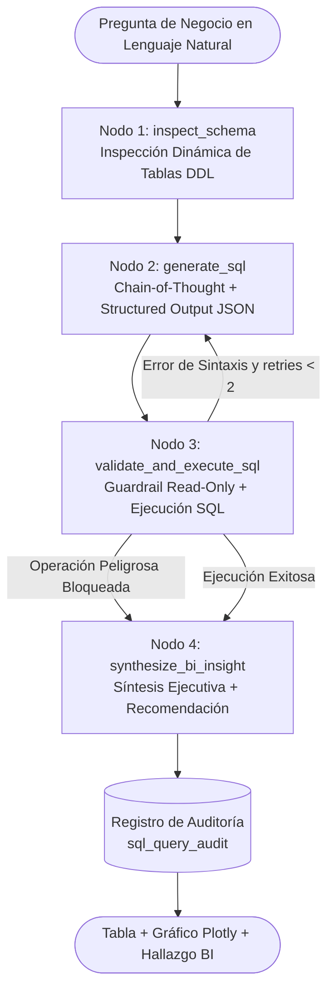

# 📊 AI Business Intelligence & SQL Analyst Agent


Agente autónomo de **Inteligencia de Negocios (BI) y Text-to-SQL** construido con **Python, LangGraph y Google Gemini 3.8 Flash**. Permite a gerentes y analistas consultar métricas comerciales complejas en lenguaje natural, generando consultas SQL optimizadas con validación de seguridad **Read-Only**, bucle de **Auto-Corrección (Self-Healing SQL)**, síntesis ejecutiva de KPIs y visualización interactiva.

---

## 🏗️ Flujo del Agente con Chain-of-Thought y Auto-Corrección (LangGraph)



---

## ✨ Características Técnicas Destacadas

1. **Inspección Dinámica de Esquema y Text-to-SQL con Structured Outputs**:
   - Extrae automáticamente metadatos de las tablas relacionales (`commercial_sales`) y planifica agregaciones (`SUM`, `AVG`, `COUNT`, `GROUP BY`) usando esquemas Pydantic y `gemini-3.8-flash`.
2. **Guardrail de Seguridad SQL (`Read-Only`)**:
   - Bloquea de forma preventiva cualquier intento de ejecución de comandos destructivos (`DROP`, `DELETE`, `UPDATE`, `INSERT`, `ALTER`, `TRUNCATE`) o inyección de múltiples sentencias.
3. **Bucle de Auto-Corrección (Self-Healing SQL)**:
   - Si una consulta SQL falla por un nombre de columna o sintaxis, la arista condicional de **LangGraph** re-enruta el mensaje de error al nodo generador para corregir la consulta automáticamente.
4. **Síntesis Ejecutiva y Visualización Automática**:
   - Selecciona dinámicamente el tipo de visualización (`bar`, `pie`, `line`) y redacta conclusiones estratégicas orientadas a la toma de decisiones comerciales.

---

## 🚀 Cómo Ejecutar el Proyecto

### 1. Instalar dependencias
```bash
pip install -r requirements.txt
```

### 2. Lanzar el Dashboard Analítico en Streamlit
```bash
streamlit run src/dashboard/bi_app.py
```

### 3. Lanzar la API REST (FastAPI)
```bash
uvicorn src.api.main:app --reload --port 8001
```

### 4. Ejecutar pruebas automatizadas (Pytest)
```bash
pytest -v
```

---

## 👤 Autor
**Joseph Pajuelo Cárdenas**  
Ingeniería de Sistemas e Informática (UTP) | Business Intelligence & AI Agents  
[LinkedIn](https://linkedin.com/in/josephpajuelo) • [GitHub](https://github.com/Joseph-Pajuelo)
